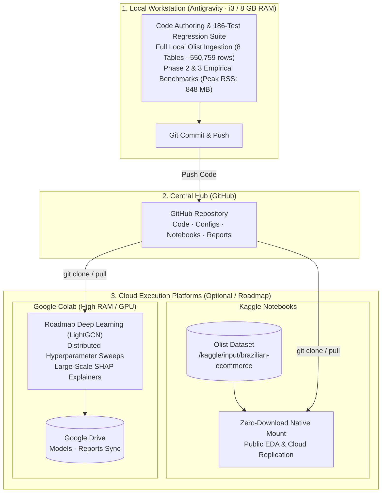
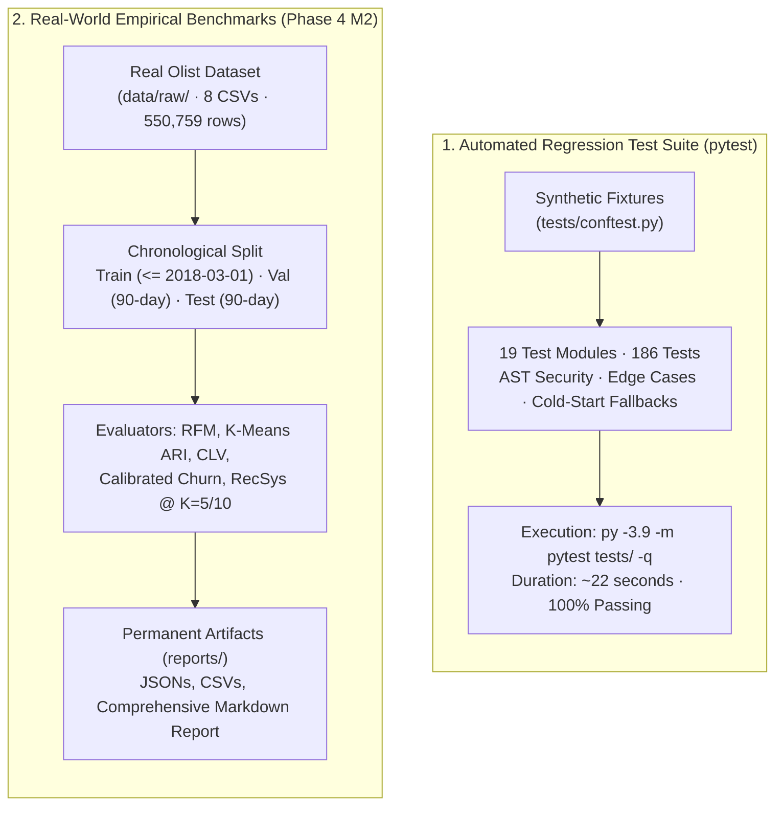

# InsightX-AI 3.0
**Autonomous E-Commerce Intelligence & Adaptive Decision Platform**

InsightX-AI 3.0 is an industry-grade, modular Machine Learning and Decision Intelligence system built on the **Brazilian Olist E-Commerce dataset** (550,759 records across 8 relational tables). It operates on a **Hybrid Development Architecture** — local workstation (Antigravity · Intel Core i3 / 8 GB RAM) for code authoring, the 186-test synthetic regression suite, full local Olist ingestion & schema quality audits, and leak-free chronological evaluation of Customer Intelligence and Recommendation Intelligence (measured peak RSS: 848 MB); Google Colab and Kaggle serve as optional cloud environments for GPU-accelerated deep learning (e.g. LightGCN roadmap), distributed parameter sweeps, and public notebook sharing.

---

## 🏗️ Hybrid Architecture & Compute Roles



**Operating Environment & Compute Roles**

| Platform | Role | Scope of Execution | Hardware Budget / Measured Footprint |
|---|---|---|---|
| **Local Workstation** (i3 / 8 GB / Windows) | Authoring, Testing & Empirical Evaluation | 186 unit/integration tests (synthetic); Full 8-table real Olist ingestion (550,759 rows); Customer Intelligence (RFM, K-Means ARI, CLV, Calibrated Churn); RecSys Intelligence (6 models @ K=5/10) | Peak RSS: 848.26 MB / Heap: 463.86 MB / Duration: 19.7 min (Pass: < 2.0 GB) |
| **Kaggle Notebooks** | Cloud EDA & Zero-Download Mirror | Pre-mounted Olist dataset exploratory analysis, interactive notebook sharing, alternative cloud baseline verification | Zero-download native mount (`/kaggle/input/brazilian-ecommerce`) |
| **Google Colab** | High-Compute & Deep Learning (Roadmap) | High-RAM GPU compute for future graph neural networks (LightGCN roadmap), distributed parameter sweeps, large-scale tree explainers | High-RAM / T4 GPU / Google Drive artifact syncing |
| **Google Drive** | Remote Cloud Backup | Long-term backup of serialized model weights, JSON evaluation reports, and figures | Cloud storage |

---

## 🎯 Platform Evolution & Roadmap Status

| Phase | Milestone | Status | Description |
|---|---|:---:|---|
| **Phase 1** | Data Foundation | **Complete** | SQLGuard AST sandbox, DuckDB isolated process, KPI catalog, temporal splitter, StructuredEvidence provenance, dual-measurement resource profiler. |
| **Phase 2** | Customer Intelligence | **Complete** | Point-in-time behavioral features, RFM segmentation, K-Means clustering, CLV engine, calibrated churn prediction, ModelExplainer attribution. |
| **Phase 3** | RecSys Intelligence | **Complete** | M1–M5: Customer-product interaction builder, 6 recommendation models (Popularity, Category, Co-Purchase, SVD CF, Content-Based, Hybrid), multi-metric evaluation, offline ranking, end-to-end integration pipeline. |
| **Phase 4** | Real Olist Ingestion (M1) | **Complete** | Full real dataset ingestion (8 tables, 550,759 rows), schema validation, foreign key integrity audit, type casting, QualityReport generator. |
| **Phase 4** | Real Model Evaluation (M2) | **Complete** | Leak-free chronological evaluation of Phase 2 & 3 on real Olist data. RFM distribution, cluster stability (ARI 0.9719), CLV GMV/net profit, BG/NBD suitability audit, calibrated churn modeling (Brier 0.0068), 6-model RecSys benchmarks @ K=5/10, repeat vs sparse vs cold-start breakdown. |
| **Phase 4** | Executive Intelligence (M3) | *Pending* | Business strategy, SQL decision intelligence, and executive BI dashboard integration. |

---

## 📋 System Capability Matrix: Implemented, Evaluated, Partially Supported, and Planned

To ensure absolute architectural clarity and eliminate ambiguity regarding current platform capabilities, all components are classified into four explicit categories:
- **Implemented**: Fully coded, modularized, unit-tested, and verified in the repository codebase.
- **Evaluated**: Empirically benchmarked against the actual 8-table Brazilian Olist dataset (550,759 rows) using strict chronological holdouts (`data/raw/`).
- **Partially Supported**: Functional under specific data densities or operational subsets (e.g. spend modeling on repeat subsets; SVD CF on warm users; cloud-targeted forecasting scripts).
- **Planned (Roadmap)**: Planned future architectures or cloud-scale expansions that have **not** been implemented or evaluated in the current codebase.

| Subsystem / Capability | Capability Status | Real Olist Evaluation | Execution Environment | Architecture & Empirical Baseline |
|---|:---:|:---:|:---:|---|
| **SQLGuard AST Sandbox** | ✅ Implemented | ✅ Evaluated (Schema) | Local | 17 AST tests; single-statement SELECT enforcement, 3s timeout |
| **DuckDB Process Sandbox** | ✅ Implemented | ✅ Evaluated (Schema) | Local | Spawn-isolated worker process, 256 MB memory cap, process kill |
| **OlistDatasetAdapter** | ✅ Implemented | ✅ Evaluated (Real Olist) | Local | 8 tables, 550,759 rows ingested; zero foreign key orphans; type normalization |
| **TemporalSplitter & Auditor** | ✅ Implemented | ✅ Evaluated (Real Olist) | Local | Chronological splits (Train: 59,099, Val: 21,022, Test: 18,971); 0 future leakage |
| **StructuredEvidence Provenance** | ✅ Implemented | ✅ Evaluated (Architecture) | Local | Immutable dataclasses; 4 provenance types (Observed, Assumed, Derived, Synthetic) |
| **Dual Resource Profiler** | ✅ Implemented | ✅ Evaluated (Real Olist) | Local | Tracemalloc heap + psutil peak RSS (848.26 MB measured peak) |
| **Point-in-Time Feature Pipeline**| ✅ Implemented | ✅ Evaluated (Real Olist) | Local | 57,511 customer feature vectors with 90-day forward prediction horizons |
| **RFM Behavioral Segmentation** | ✅ Implemented | ✅ Evaluated (Real Olist) | Local | 55,268 delivered customers classified into 10 distinct cohorts |
| **K-Means Behavioral Clustering** | ✅ Implemented | ✅ Evaluated (Real Olist) | Local | RobustScaler + 4 clusters; 5 seeds tested; Mean ARI = 0.9719 (Threshold $\ge 0.75$) |
| **CLV Engine (Historical & Projected)**| ✅ Implemented | ✅ Evaluated (Real Olist) | Local | Realized GMV: R$9.42M, Net Profit: R$282.5K, Forward 1-Yr Net Profit: R$7,959.54 |
| **Probabilistic CLV (BG/NBD & Gamma-Gamma)**| ⚠️ Partially Supported | ✅ Evaluated (Real Olist) | Local | BG/NBD degenerate on full population (2.56% repeat); Gamma-Gamma valid on repeat subset ($r = -0.0080, p = 0.7587$); Dual-track architecture deployed. Note: BG/NBD predictive holdout validation on the repeat subset remains a future production-readiness task. |
| **Calibrated Churn Prediction** | ✅ Implemented | ✅ Evaluated (Real Olist) | Local | Calibrated Logistic Regression: PR-AUC 0.9957, ROC-AUC 0.6332, Brier 0.0068 |
| **ModelExplainer Attribution** | ✅ Implemented | ✅ Evaluated (Real Olist) | Local | Standardized coefficients: `total_orders` (0.3206), `avg_order_value` (0.2993) |
| **Interaction Matrix Builder** | ✅ Implemented | ✅ Evaluated (Real Olist) | Local | 94,694 customers $\times$ 32,547 products (101,213 pairs, 99.9967% sparsity) |
| **Popularity Recommender** | ✅ Implemented | ✅ Evaluated (Real Olist) | Local | P@10: 0.00340, Coverage: 0.033%, ILD: 0.800, ARP: 229.09, Gini: 0.9995 |
| **Category Recommender** | ✅ Implemented | ✅ Evaluated (Real Olist) | Local | P@10: 0.00338, Coverage: 1.269%, ILD: 0.785, ARP: 225.88, Gini: 0.9994 |
| **Co-Purchase Recommender (Jaccard)**| ✅ Implemented | ✅ Evaluated (Real Olist) | Local | P@10: 0.00340, Coverage: 1.175%, ILD: 0.799, ARP: 227.58, Gini: 0.9995 |
| **SVD Collaborative Filter** | ⚠️ Partially Supported | ✅ Evaluated (Real Olist) | Local | Effective on warm users; cold-start users have zero latent vector and fall back to hybrid ensemble |
| **Content-Based Recommender (TF-IDF)**| ✅ Implemented | ✅ Evaluated (Real Olist) | Local | P@10: 0.00004, Coverage: 10.558%, ILD: 0.072, ARP: 4.59, Gini: 0.9002 |
| **Hybrid Ensemble Recommender** | ✅ Implemented | ✅ Evaluated (Real Olist) | Local | P@10: 0.00338, Coverage: 7.396% (221x over Popularity), ILD: 0.791, Gini: 0.9981 |
| **Customer & RecSys Integration** | ✅ Implemented | ✅ Evaluated (Real Olist) | Local | Segment-wise routing: Repeat cohort P@10 = 0.00635 (+87%), Sparse cohort 6.498% coverage, Cold-start fallback |
| **Comprehensive RecSys Evaluator** | ✅ Implemented | ✅ Evaluated (Real Olist) | Local | 20,665 validation customers evaluated across 7 metrics at K=5 and K=10 |
| **Time-Series Forecasting (`forecasting.py`)**| ⚠️ Partially Supported | 🧪 Unit-Tested (Synthetic) | Cloud | Prophet/ARIMA time-series pipeline implemented in source; full cloud training planned |
| **LightGCN (Graph Neural Network)** | ❌ Planned (Roadmap) | ❌ NOT Evaluated | Cloud / GPU | **Roadmap Item**: Bipartite user-item graph convolution; requires PyTorch Geometric / DGL & GPU |
| **Dynamic Multi-Objective Re-ranking**| ❌ Planned (Roadmap) | ❌ NOT Evaluated | — | **Roadmap Item**: Margin-aware, live stock, and delivery SLA constrained optimization |
| **Demand Forecasting & Stockouts** | ❌ Planned (Roadmap) | ❌ NOT Evaluated | Cloud | **Roadmap Item**: Hierarchical category demand forecasting (Prophet/LightGBM) & anomaly detection |
| **Online Causal A/B Testing & Bandits**| ❌ Planned (Roadmap) | ❌ NOT Evaluated | — | **Roadmap Item**: Contextual bandits (Thompson Sampling) and causal incrementality measurement |
| **Phase 4 M3: SQL Decision Agent** | ⏳ Planned (Roadmap) | ❌ NOT Evaluated | Local / Cloud | **Roadmap Item**: Conversational natural language SQL decision agent & executive BI dashboard |

---

## Historical Phase 1 Limitations and Resolutions

> [!NOTE]
> **Preserving Architectural Provenance**: During Phase 1 (Data Foundation), the project operated under a set of initial design constraints and assumptions. To maintain historical documentation integrity, all original Phase 1 limitations are preserved below alongside their subsequent Phase 4 empirical resolution and current operational status.

1. **No real data locally**:
   - *Original Phase 1 Limitation*: All tests used synthetic in-memory DataFrames. The documentation stated that the Olist dataset must be accessed via Kaggle or Google Colab.
   - *Phase 4 Resolution*: Fully resolved in Phase 4 M1 & M2. All 8 raw Olist CSV files (550,759 records, 196.22 MB raw) are stored locally in `data/raw/`. The `OlistDatasetAdapter` and `OlistDataLoader` successfully ingest, clean, validate schemas, and normalize data types locally without requiring cloud infrastructure.
2. **Windows multiprocessing**:
   - *Original Phase 1 Limitation*: DuckDB sandbox uses `multiprocessing.spawn` (Windows default). Worker functions are module-level. DuckDB connections are initialized inside the child process — not passed across process boundaries.
   - *Phase 4 Status*: Preserved. Windows multiprocessing constraints remain active in `SQLGuard` to ensure total isolation, resource enforcement, and process termination safety.
3. **Timeout is a target, not a hard guarantee**:
   - *Original Phase 1 Limitation*: The 3-second wall-clock timeout triggers `proc.terminate()` followed by `proc.kill()`. OS scheduling may add up to ~0.5 s of latency between the signal and actual termination.
   - *Phase 4 Status*: Preserved. Process termination latency remains a known behavioral characteristic of OS process management.
4. **Memory limits are profiling targets**:
   - *Original Phase 1 Limitation*: The 256 MB DuckDB engine memory setting and the 15-second / 250 MB local profiling targets are configuration values, not enforced hard limits. Peak RSS is measured and reported but not enforced as a hard kill threshold.
   - *Phase 4 Resolution*: Empirically validated on real data. Full ingestion, feature extraction, RFM segmentation, calibrated churn training, and 6-model recommendation evaluation across 20,665 validation customers consumed a peak process RSS of **848.26 MB** (well within the 8 GB machine budget). While this demonstrates acceptable, stable memory usage for the tested Olist workload within an 8 GB workstation, it does not convert configured memory limits into hard enforcement limits; peak RSS remains a diagnostic measurement rather than a kernel-enforced termination threshold.
5. **SQL wildcard expansion**:
   - *Original Phase 1 Limitation*: `SELECT *` is allowed and secured by DataFrame pre-filtering, not AST rewriting. This is intentional — AST rewriting would break queries against DataFrames that expose fewer columns than the full allowlist.
   - *Phase 4 Status*: Preserved. DataFrame pre-filtering continues to guarantee that unapproved columns can never be accessed.
6. **No Phase 2 modules yet**:
   - *Original Phase 1 Limitation*: Recommendation intelligence, collaborative filtering, LightGCN, CLV estimation, churn modelling, and the adaptive decision layer are not implemented.
   - *Phase 4 Resolution*: Resolved. Core Phase 2 Customer Intelligence and Phase 3 Recommendation Intelligence modules implemented and evaluated on real Olist data in Phase 4 M2. LightGCN and the adaptive decision layer are explicitly retained as planned capabilities.
7. **README describes planned roadmap**:
   - *Original Phase 1 Limitation*: Capability sections above that are not yet implemented are labelled as roadmap items.
   - *Phase 4 Status*: Resolved. Capabilities are now explicitly delineated via the formal System Capability Matrix above into Implemented, Evaluated, Partially Supported, and Planned categories.

---

## 🔬 Testing Architecture: Synthetic vs Real-Data Benchmarks

InsightX-AI enforces a strict separation between automated regression test suites and real-world empirical benchmarks:



- **Synthetic Unit & Integration Tests (186/186 passing)**:
  - Fast, deterministic, and isolated from large disk datasets.
  - Verifies AST query validation, SQL injection blocks, schema guards, zero-division handlers, NaN feature handling, model training interfaces, and cold-start fallback logic.
  - Runs in ~22 seconds via `py -3.9 -m pytest tests/ -q`.
- **Real-World Empirical Evaluation (Phase 4 M2)**:
  - Runs directly on the actual 550,759 records from `data/raw/`.
  - Evaluates true behavioral sparsity (99.9967%), 97.0% one-time buyer churn reality, K-Means ARI stability across random seeds (0.9719), CLV net profit (R$282.5K), and 6 recommendation models on 20,665 validation customers.
  - Generates permanent structured artifacts in `reports/` (`real_olist_m2_evaluation.json`, CSV summaries).

---

## 📊 Phase 4 M2: Real Olist Empirical Evaluation Summary

Phase 4 Milestone 2 benchmarked the complete Customer Intelligence and Recommendation Intelligence pipelines against the actual Brazilian Olist E-Commerce dataset using strict chronological holdouts:
- **Train Window**: Earliest Transaction to `2018-03-01 00:00:00` (59,099 orders, 56,354 customers, 20,803 active catalog items)
- **Validation Window**: `2018-03-01 00:00:01` to `2018-05-31 23:59:59` (90-day forward horizon; 21,022 orders, 20,665 unique customers, 21,684 interaction pairs)
- **Test Window**: `2018-06-01 00:00:01` to `2018-08-31 23:59:59` (18,971 sequestered test orders)

### Key Empirical Findings:
1. **Behavioral Segmentation & Stability**:
   - RFM segmented 55,268 delivered customers into 10 cohorts. High-value Champions and Loyal Customers make up 2.33% of the base, while At-Risk, Lost, and About-to-Sleep cohorts represent 49.28%.
   - K-Means cluster stability across 5 random seeds achieved **Mean ARI = 0.9719** (min 0.9489, max 0.9935; threshold $\ge 0.75$).
2. **Customer Lifetime Value & Model Suitability**:
   - Total Realized Historical GMV: **R$9,416,761.00** | Net Marketplace Profit: **R$282,497.53** (at 15% take rate and 20% operating margin).
   - Forward 1-year projected net profit: **R$7,959.54** reflecting the 97.0% one-time buyer drop-off.
   - Probabilistic suitability: BG/NBD is **UNSUITABLE** for full-dataset modeling due to 2.56% repeat buyer density at cutoff. Gamma-Gamma spend-frequency independence **HOLDS** on the repeat cohort ($r = -0.0080, p = 0.7587$). Note: full predictive validation of forward purchase timing using BG/NBD on this repeat-customer subset remains a future production-readiness task.
3. **Calibrated Churn Prediction**:
   - Active cohort: 57,511 customers | Base churn rate: 99.31% (395 repeat purchasers).
   - Calibrated Logistic Regression achieved **PR-AUC = 0.9957**, **ROC-AUC = 0.6332**, **Brier Score = 0.0068**, and **Precision@Top10% = 0.9972** (reducing probability error from heuristic baseline Brier of 0.5249).
4. **Recommendation Models @ K=10**:
   - **Popularity**: P@10 = 0.00340, R@10 = 0.03274, NDCG@10 = 0.01384, Coverage = 0.033%, Diversity = 0.800, ARP = 229.09, Gini = 0.9995.
   - **Hybrid Ensemble**: P@10 = 0.00338, R@10 = 0.03247, NDCG@10 = 0.01373, **Coverage = 7.396%** (221x higher catalog exploration than Popularity), Diversity = 0.791, ARP = 225.71, Gini = 0.9981.
   - **Repeat Customer Advantage**: On customers with $\ge 2$ past purchases, Hybrid recommendation precision jumped to **P@10 = 0.00635** (+87% relative uplift), **NDCG@10 = 0.02412** (+76% ranking boost), and ARP dropped from 229.1 to **61.26** as recommendations shifted to personalized long-tail items.

---

## ✅ Phase 1 — Implemented (Data Intelligence Foundation)

Phase 1 establishes the core data infrastructure, security layer, provenance system, and temporal-split discipline that all later phases build on.

### Phase 1 Modules

| Module | Path | Description |
|---|---|---|
| **SQLGuard** | `src/insightx/agent/sql_guard.py` | Defense-in-depth SQL security guard and process-isolated DuckDB sandbox |
| **SQL KPI Catalog** | `src/insightx/data/sql_catalog.py` | Approved analytical KPI queries (monthly revenue, top categories, delivery performance) |
| **Data Validator** | `src/insightx/data/validator.py` | Temporal leakage validator and empirical repeat-purchase rate engine |
| **Temporal Splitter** | `src/insightx/data/splitter.py` | Strict chronological train/val/test partitioner with leakage audit metadata |
| **Provenance Engine** | `src/insightx/provenance/` | Immutable `StructuredEvidence` objects with dataset ID, query hash, execution ID, units, calculation provenance, and four provenance types |
| **Resource Profiler** | `src/insightx/utils/profiling.py` | Dual-measurement profiler: Python heap via `tracemalloc` + OS process peak RSS via `psutil` |
| **Guardrail Config** | `configs/agent_guardrails.yaml` | YAML policy defining allowed views, columns, functions, prohibited keywords, and execution limits |

### SQLGuard Security Architecture

`SQLGuard` enforces defense-in-depth through two independent layers:

**Layer 1 — AST validation** (before execution):
- Single-statement isolation: rejects multi-statement chains (`; DROP TABLE …`).
- Root-type enforcement: only `SELECT` permitted; DDL/DML rejected.
- View allowlisting: only the 7 configured `v_*` views are accessible.
- Column allowlisting: explicit column references checked against per-view schema.
- Function allowlisting: only 12 approved scalar/aggregate functions allowed.
- Prohibited keyword blacklist: `read_csv`, `httpfs`, `pragma`, `information_schema`, etc.
- Schema-qualifier rejection: `duckdb.*`, `information_schema.*` blocked.
- CTE and subquery traversal: all nested scopes validated recursively.
- SQL comment safety: `--` and `/* */` comments parsed safely via sqlglot, not stripped with regex.
- `LIMIT` enforcement: auto-injects `LIMIT 500`; clamps user-supplied limits.

**Layer 2 — DataFrame column filtering** (before DuckDB execution):
- Every registered DataFrame is pre-filtered to only its allowlisted columns before the worker process receives it.
- `SELECT *` and qualified wildcards (`tbl.*`) in CTEs and subqueries can never expose unauthorized columns regardless of DataFrame content.
- Implemented in `execute_safely()` with process-level isolation (Windows spawn-compatible).

**Process isolation**:
- DuckDB runs inside a separately-spawned child process (`multiprocessing.Process`).
- `enable_external_access = false`, `max_memory = 256 MB`, `threads = 1`.
- Deterministic timeout via physical process termination (`proc.terminate()` → `proc.kill()`).
- All worker arguments and results are serializable (no DuckDB connections cross process boundaries).

```python
from insightx.agent.sql_guard import SQLGuard

guard = SQLGuard()                          # loads configs/agent_guardrails.yaml
df = guard.execute_safely(
    "SELECT order_id, payment_value FROM v_orders JOIN v_order_payments …",
    tables_data={"v_orders": df_orders, "v_order_payments": df_payments},
    timeout_seconds=3.0,
)
```

### Provenance System

Every analytical claim is backed by an immutable `StructuredEvidence` object:

```python
from insightx.provenance import StructuredEvidence, ProvenanceType

evidence = StructuredEvidence(
    provenance_type=ProvenanceType.OBSERVED,
    dataset_id="olist-v1.0",
    query_hash="sha256:abc123…",
    execution_id="exec-2026-10-31-001",
    claim="Monthly revenue for 2018-01 = R$1,234,567",
    raw_value=1_234_567.0,
    units="BRL",
    result_row_or_key=("2018-01",),
    calculation_provenance="SUM(payment_value) WHERE order_status='delivered'",
)
```

Four provenance types: `OBSERVED`, `ASSUMED`, `DERIVED`, `SYNTHETIC_TEST`.

### Temporal Splitter

Strict chronological boundaries prevent future-data leakage:

| Split | Default boundary |
|---|---|
| Train start | 2017-01-01 |
| Train end | 2018-03-01 |
| Validation end | 2018-05-31 |
| Test end | 2018-08-31 |

Customer overlap between training and test splits is **intentional** for repeat-customer evaluation. Leakage validation focuses on future events entering historical features, not customer identity.

---

## 📁 Repository Structure

```text
InsightX-AI/
├── .env.example                    # Template — copy to .env and fill API keys (never commit .env)
├── .gitignore                      # Excludes credentials, venvs, model binaries
├── pyproject.toml                  # PEP 517 build spec, editable install, pytest config
├── requirements.txt                # Runtime and development dependencies
├── README.md
│
├── configs/
│   ├── base_config.yaml            # Multi-environment paths (local / kaggle / colab) and seed
│   ├── model_config.yaml           # Hyperparameters, RFM weights, evaluation config
│   └── agent_guardrails.yaml       # SQL security policy: allowed views, columns, functions
│
├── data/
│   ├── raw/                        # 8 Brazilian Olist CSV files (550,759 rows, locally present)
│   ├── interim/
│   └── processed/
│
├── reports/                        # Permanent evaluation artifacts & benchmark outputs
│   ├── phase4_m2_real_evaluation_report.md  # Comprehensive evaluation report
│   ├── real_olist_m2_evaluation.json        # Machine-readable metric benchmarks
│   ├── recommendation_metrics_k10.csv       # 6-model recsys metrics @ K=10
│   ├── recommendation_metrics_k5.csv        # 6-model recsys metrics @ K=5
│   ├── recommendation_segment_breakdown_k10.csv # Cohort breakdown (Repeat vs Sparse vs Cold)
│   ├── rfm_segment_distribution.csv         # 10 RFM cohort distributions
│   ├── churn_evaluation_summary.json        # Calibrated logistic regression & baseline
│   ├── clv_metrics_summary.json             # Realized GMV, profit & suitability audit
│   └── resource_profiling_summary.json      # Peak RSS (848 MB) and runtime profile
│
├── notebooks/
│   └── 01_cloud_starter_eda.ipynb  # Cloud-ready (Colab & Kaggle)
│
├── src/insightx/
│   ├── __init__.py
│   ├── config.py                   # Environment-agnostic path resolver
│   ├── agent/
│   │   └── sql_guard.py            # Defense-in-depth SQL security guard + DuckDB sandbox
│   ├── data/
│   │   ├── adapter.py              # OlistDatasetAdapter (8-table ingestion, cleaning, types)
│   │   ├── loader.py               # Multi-environment Olist table loader with adapter support
│   │   ├── recommendation_data.py  # CustomerProductInteractionBuilder & metadata matrix
│   │   ├── splitter.py             # Temporal train/val/test splitter with leakage metadata
│   │   ├── sql_catalog.py          # Approved KPI query catalog
│   │   ├── sql_queries.py          # DuckDB analytical KPI queries
│   │   └── validator.py            # Temporal leakage validator + empirical repeat-rate engine
│   ├── features/
│   │   ├── engineering.py          # Point-in-time customer feature matrix builder
│   │   └── rfm.py                  # RFM feature calculation, scoring, and cohort assignment
│   ├── insights/
│   │   ├── behaviour.py            # ModelExplainer standardized feature attribution
│   │   └── generator.py            # Executive briefing and recommendation generator
│   ├── models/
│   │   ├── churn.py                # Calibrated logistic regression churn predictor & heuristic
│   │   ├── clv.py                  # CLV engine (GMV, profit, BG/NBD & Gamma-Gamma audit)
│   │   ├── collaborative_filtering.py # TruncatedSVD collaborative filtering
│   │   ├── content_based.py        # TF-IDF product metadata content-based recommender
│   │   ├── hybrid_recommender.py   # Multi-candidate weighted ensemble recommender
│   │   ├── recommenders.py         # Popularity, Category, and Co-Purchase baseline models
│   │   ├── recommendation_eval.py  # Precision@K, Recall@K, NDCG@K ranking metrics
│   │   ├── comprehensive_eval.py   # Coverage, Intra-List Diversity, ARP, Gini index
│   │   ├── recommendation_pipeline.py # 6-model recommendation pipeline integration
│   │   ├── repeat_purchase.py      # Supervised repeat-purchase classifier
│   │   ├── segmentation.py         # K-Means clustering, transform, ARI stability
│   │   ├── forecasting.py          # Time-series revenue forecasting
│   │   └── explainability.py       # Interpretability modules
│   ├── provenance/
│   │   ├── evidence.py             # Immutable StructuredEvidence dataclass
│   │   └── types.py                # ProvenanceType enum (OBSERVED/ASSUMED/DERIVED/SYNTHETIC_TEST)
│   ├── utils/
│   │   ├── logger.py               # Structured standard logging
│   │   └── profiling.py            # Dual-measurement resource profiler (tracemalloc + psutil RSS)
│   └── dashboard/
│       └── app.py                  # Streamlit interactive BI dashboard
│
└── tests/                          # 19 test modules · 186 unit/integration tests (100% passing)
    ├── conftest.py                 # Shared synthetic data fixtures & mock generators
    ├── test_advanced_recommenders.py
    ├── test_behaviour_insights.py
    ├── test_churn.py
    ├── test_clv.py
    ├── test_comprehensive_eval.py
    ├── test_config.py
    ├── test_customer_intelligence_integration.py
    ├── test_dataset_adapter.py
    ├── test_feature_engineering.py
    ├── test_profiling.py
    ├── test_provenance.py
    ├── test_recommendation_data.py
    ├── test_recommendation_pipeline_integration.py
    ├── test_recommenders.py
    ├── test_rfm.py
    ├── test_segmentation.py
    ├── test_sql_catalog.py
    ├── test_sql_guard.py
    └── test_temporal_splitter.py
```

---

## 🔒 Security Policy

### What is allowed
- `SELECT` queries only, single statement per call.
- Views: `v_orders`, `v_order_items`, `v_order_payments`, `v_order_reviews`, `v_customers`, `v_products`, `v_sellers`.
- Functions: `SUM`, `AVG`, `COUNT`, `MIN`, `MAX`, `ROUND`, `STRFTIME`, `DATE_TRUNC`, `COALESCE`, `NULLIF`, `ABS`, `DATE_DIFF`.
- CTEs and subqueries referencing allowed views.
- SQL comments (`--`, `/* */`).

### What is blocked
- DDL/DML (`INSERT`, `UPDATE`, `DELETE`, `DROP`, `CREATE`, `ALTER`).
- Statement chaining (`; SELECT …`).
- External data access (`read_csv`, `read_parquet`, `httpfs`, `install`, `load`, `copy`).
- System schema snooping (`information_schema`, `duckdb_tables`, `pragma`, `sqlite_master`).
- Schema qualifiers other than `main` (e.g. `duckdb.*`).
- Unapproved columns — even via `SELECT *` (DataFrames are pre-filtered to allowlisted columns).
- Result sets exceeding 500 rows (auto-clamped).
- Queries exceeding 3-second wall-clock timeout (worker process killed).

---

## 📦 Dependencies

| Package | Version | Purpose |
|---|---|---|
| `pandas` | ≥ 2.0.0 | Dataframe manipulation |
| `numpy` | ≥ 1.24.0 | Numerical computing |
| `duckdb` | ≥ 0.9.0, < 1.2.0 | In-memory analytical SQL engine |
| `sqlglot` | ≥ 23.0.0 | SQL AST parsing and validation |
| `psutil` | ≥ 5.9.0 | Process-level peak RSS measurement |
| `pyyaml` | ≥ 6.0.1 | YAML config loading |
| `scikit-learn` | ≥ 1.3.0 | K-Means, classification models |
| `xgboost` | ≥ 2.0.0 | Gradient boosting (Colab) |
| `lightgbm` | ≥ 4.1.0 | Gradient boosting (Colab) |
| `shap` | ≥ 0.43.0 | Model explainability (Colab) |
| `prophet` | ≥ 1.1.5 | Time-series forecasting (Colab) |
| `streamlit` | ≥ 1.28.0 | Interactive BI dashboard |
| `plotly` | ≥ 5.17.0 | Interactive visualisations |
| `pydantic` | ≥ 2.4.0 | Data validation |
| `pytest` | ≥ 7.4.0 | Test runner |

> **Note**: Core data ingestion, schema adaptation, customer intelligence (RFM, K-Means, CLV, Calibrated Churn), and all 6 recommendation algorithms (Popularity, Category, Co-Purchase, SVD CF, Content-Based, Hybrid) execute locally using standard runtime dependencies (`duckdb`, `sqlglot`, `psutil`, `pyyaml`, `scikit-learn`, `pandas`, `numpy`). Heavy cloud libraries (`xgboost`, `lightgbm`, `shap`, `prophet`) are listed in `requirements.txt` for cloud environment completeness and future deep model milestones.

---

## 🧪 Running Tests & Empirical Benchmarks

### 1. Automated Synthetic Regression Test Suite (186 tests, ~22 seconds)
Runs unit and integration tests using deterministic synthetic fixtures to verify AST guards, edge cases, schema boundaries, and cold-start fallbacks:

```powershell
py -3.9 -m pytest tests/ -q
```

**Full Regression Test Suite (186 tests, 100% passing):**

| Test Module | Focus Area | Status |
|---|---|:---:|
| `test_config.py` | Config loading, path resolver, multi-environment resolution | Pass |
| `test_profiling.py` | Dual-measurement profiler (tracemalloc heap + psutil peak RSS) | Pass |
| `test_provenance.py` | StructuredEvidence immutability, type coverage, serialization | Pass |
| `test_sql_catalog.py` | Analytical KPI catalog queries (DuckDB execution) | Pass |
| `test_sql_guard.py` | AST security enforcement + wildcard adversarial injection | Pass |
| `test_temporal_splitter.py` | Chronological boundaries, future leakage auditing, overlap | Pass |
| `test_dataset_adapter.py` | OlistDatasetAdapter schema normalization, types, foreign key audit | Pass |
| `test_feature_engineering.py` | Point-in-time behavioral features, forward horizon targets | Pass |
| `test_rfm.py` | RFM calculation, integer frequency binning, segment assignment | Pass |
| `test_segmentation.py` | K-Means clustering, transform, ARI stability across random seeds | Pass |
| `test_clv.py` | Historical GMV, parameterized net profit, BG/NBD suitability | Pass |
| `test_churn.py` | Heuristic baseline, calibrated logistic regression, Brier score | Pass |
| `test_behaviour_insights.py` | ModelExplainer feature attribution, behavioral insights | Pass |
| `test_recommendation_data.py` | CustomerProductInteractionBuilder, product metadata matrix | Pass |
| `test_recommenders.py` | Popularity, Category, and Co-Purchase baseline models | Pass |
| `test_advanced_recommenders.py` | SVD Collaborative Filtering and Content-Based recommender | Pass |
| `test_comprehensive_eval.py` | Evaluation metrics (P@K, R@K, NDCG@K, Diversity, ARP, Gini) | Pass |
| `test_recommendation_pipeline_integration.py` | 6-model recommendation pipeline, cold-start fallbacks | Pass |
| `test_customer_intelligence_integration.py` | End-to-end integration of Customer & RecSys intelligence | Pass |

### 2. Real-World Olist Empirical Benchmark (Phase 4 M2, ~19.7 minutes)
Ingests the 8 raw Olist CSVs from `data/raw/` (550,759 rows) and executes the complete chronological evaluation across Customer Intelligence and RecSys models:

```powershell
py -3.9 scratch/run_real_m2_benchmark.py
```

---

## ⚠️ Genuine Empirical Limitations & Methodological Guardrails (Phase 4 M2)

1. **Cold-Start Dominance in Olist**: In the held-out 90-day validation window, 98.04% of active users (20,259 of 20,665) are completely new with zero interaction history in the training matrix. Recommendations gracefully and deterministically fall back to popularity and category ensembles; personalization improvements materialize for the repeat-purchaser cohort (+87% Precision@10, +76% NDCG@10).
2. **Extreme Interaction Sparsity**: The Olist interaction matrix has an extreme sparsity of 99.9967% (only 101,213 observed interactions across 94,694 customers $\times$ 32,547 products). Latent matrix factorizers (SVD CF) exhibit low stand-alone ranking precision across the general cold-start population, acting primarily as a collaborative candidate generator within the Hybrid ensemble.
3. **Lack of Causal Uplift Validation (Offline vs. Online Gap)**: Precision@K, Recall@K, and NDCG@K measure how accurately algorithms reconstruct un-intervened organic behavior. High popularity precision reflects observational bias, not causal incrementality. Measuring true business lift requires live online randomized controlled trials (A/B testing) with holdout control groups.
4. **Unavailable External Business Data**: The Olist dataset lacks real-time inventory levels, dynamic cost-of-goods-sold (COGS), actual carrier shipping margins, clickstream user browsing sessions, and marketing campaign exposure logs. Financial take rates (15%) and operating margins (20%) are parameterized business assumptions.
5. **Probabilistic CLV Boundary Degeneracy**: Full-cohort BG/NBD modeling degenerates on Olist due to the 97.4% one-time buyer rate (2.56% repeat rate at cutoff). BG/NBD must be deployed strictly in a dual-track architecture: heuristic recency decay for one-time buyers, and probabilistic Gamma-Gamma + BG/NBD strictly for the repeat-buyer subset ($r = -0.0080, p = 0.7587$). Note: Full predictive holdout validation of forward purchase timing on this repeat-customer subset remains a future production-readiness task.
6. **Point-in-Time Review & Delivery Audit**: In production, customer reviews and delivery confirmations occur days or weeks after purchase. The feature pipeline strictly masks all delivery timestamps and review scores that post-date the observation cutoff to eliminate lookahead leakage.
7. **Windows Process Isolation Latency**: Worker process termination in the DuckDB sandbox uses `multiprocessing.Process.terminate()` and `kill()`; OS scheduling jitter may add up to ~0.5s of latency between the signal and actual process cleanup.

---

## 🚀 Setting Up for Cloud Execution (Colab & Kaggle)

### Push to GitHub first

```powershell
git remote add origin https://github.com/namrata-dev1/InsightX-AI.git
git push -u origin master   # or: -u origin main (match your GitHub default branch)
```

### Google Colab

```python
!git clone https://github.com/namrata-dev1/InsightX-AI.git
%cd InsightX-AI
!pip install -e . -q
!pip install duckdb sqlglot psutil -q
```

Pull latest code without restarting:
```python
!git pull
```

### Kaggle Notebooks

```python
!git clone https://github.com/namrata-dev1/InsightX-AI.git
%cd InsightX-AI
!pip install -e . -q
# Olist dataset is pre-mounted at:
# /kaggle/input/brazilian-ecommerce/
```

---

## 📋 Environment Variables

Copy `.env.example` to `.env` and fill in your values. **Never commit `.env`.**

```bash
# .env.example — template only
GOOGLE_DRIVE_ARTIFACT_PATH=/content/drive/MyDrive/InsightX-AI/artifacts
KAGGLE_USERNAME=your_kaggle_username
KAGGLE_KEY=your_kaggle_api_key
GEMINI_API_KEY=your_gemini_api_key
RANDOM_SEED=42
```
