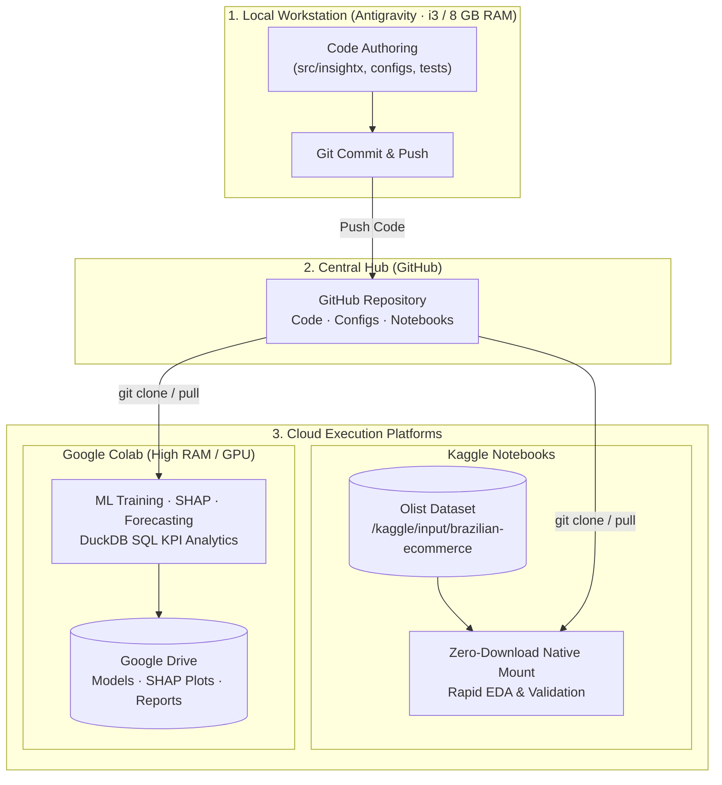

# InsightX-AI 3.0
**Autonomous E-Commerce Intelligence & Adaptive Decision Platform**

InsightX-AI 3.0 is an industry-grade, modular Machine Learning and Decision Intelligence system built on the **Olist Brazilian E-Commerce dataset**. It uses a **Hybrid Cloud Development Architecture** — local for lightweight code authoring and unit testing, Google Colab and Kaggle for heavy ML training, SHAP analysis, and large-scale EDA.

---

## 🏗️ Hybrid Cloud Architecture



**Operating constraints (hardware-aware)**

| Platform | Role | What runs there |
|---|---|---|
| Local (i3 / 8 GB / no GPU) | Code authoring, unit tests | Synthetic data only — no raw Olist dataset |
| Kaggle | EDA, data validation | Native dataset mount, no download needed |
| Google Colab | Heavy ML, SHAP, forecasting | LightGBM, XGBoost, Prophet, full Olist |
| Google Drive | Artifact storage | `.joblib` models, SHAP plots, reports |

---

## 🎯 Target Capabilities (Full Roadmap)

1. **Recommendation Intelligence** — Collaborative filtering, content-based, hybrid, graph-based (LightGCN), cold-start, multi-objective ranking, diversity/novelty evaluation.
2. **Customer Behaviour Intelligence** — RFM segmentation, cohort retention, repeat-purchase prediction, churn-risk, CLV with documented assumptions, SHAP explanations.
3. **Demand & Inventory Intelligence** — Temporal demand forecasting, anomaly detection, demand-constrained recommendation re-ranking.
4. **SQL Decision Intelligence** — Natural-language-to-SQL agent with defense-in-depth security, KPI catalog, structured evidence provenance.
5. **Adaptive Decision Layer** — Simulation-backed sensitivity analysis, multi-objective optimisation with parameterised business assumptions.

---

## ✅ Phase 1 — Implemented (Data Intelligence Foundation)

Phase 1 establishes the core data infrastructure, security layer, provenance system, and temporal-split discipline that all later phases build on.

### Phase 1 Modules

| Module | Path | Description |
|---|---|---|
| **SQLGuard** | `src/insightx/agent/sql_guard.py` | Defense-in-depth SQL security guard and process-isolated DuckDB sandbox |
| **SQL KPI Catalog** | `src/insightx/data/sql_catalog.py` | Approved analytical KPI queries (monthly revenue, top categories, delivery performance) |
| **Data Validator** | `src/insightx/data/validator.py` | Temporal leakage validator and empirical repeat-purchase rate engine |
| **Temporal Splitter** | `src/insightx/data/splitter.py` | Strict chronological train/val/test partitioner with leakage audit metadata |
| **Provenance Engine** | `src/insightx/provenance/` | Immutable `StructuredEvidence` objects with dataset ID, query hash, execution ID, units, calculation provenance, and four provenance types |
| **Resource Profiler** | `src/insightx/utils/profiling.py` | Dual-measurement profiler: Python heap via `tracemalloc` + OS process peak RSS via `psutil` |
| **Guardrail Config** | `configs/agent_guardrails.yaml` | YAML policy defining allowed views, columns, functions, prohibited keywords, and execution limits |

### SQLGuard Security Architecture

`SQLGuard` enforces defense-in-depth through two independent layers:

**Layer 1 — AST validation** (before execution):
- Single-statement isolation: rejects multi-statement chains (`; DROP TABLE …`).
- Root-type enforcement: only `SELECT` permitted; DDL/DML rejected.
- View allowlisting: only the 7 configured `v_*` views are accessible.
- Column allowlisting: explicit column references checked against per-view schema.
- Function allowlisting: only 12 approved scalar/aggregate functions allowed.
- Prohibited keyword blacklist: `read_csv`, `httpfs`, `pragma`, `information_schema`, etc.
- Schema-qualifier rejection: `duckdb.*`, `information_schema.*` blocked.
- CTE and subquery traversal: all nested scopes validated recursively.
- SQL comment safety: `--` and `/* */` comments parsed safely via sqlglot, not stripped with regex.
- `LIMIT` enforcement: auto-injects `LIMIT 500`; clamps user-supplied limits.

**Layer 2 — DataFrame column filtering** (before DuckDB execution):
- Every registered DataFrame is pre-filtered to only its allowlisted columns before the worker process receives it.
- `SELECT *` and qualified wildcards (`tbl.*`) in CTEs and subqueries can never expose unauthorized columns regardless of DataFrame content.
- Implemented in `execute_safely()` with process-level isolation (Windows spawn-compatible).

**Process isolation**:
- DuckDB runs inside a separately-spawned child process (`multiprocessing.Process`).
- `enable_external_access = false`, `max_memory = 256 MB`, `threads = 1`.
- Deterministic timeout via physical process termination (`proc.terminate()` → `proc.kill()`).
- All worker arguments and results are serializable (no DuckDB connections cross process boundaries).

```python
from insightx.agent.sql_guard import SQLGuard

guard = SQLGuard()                          # loads configs/agent_guardrails.yaml
df = guard.execute_safely(
    "SELECT order_id, payment_value FROM v_orders JOIN v_order_payments …",
    tables_data={"v_orders": df_orders, "v_order_payments": df_payments},
    timeout_seconds=3.0,
)
```

### Provenance System

Every analytical claim is backed by an immutable `StructuredEvidence` object:

```python
from insightx.provenance import StructuredEvidence, ProvenanceType

evidence = StructuredEvidence(
    provenance_type=ProvenanceType.OBSERVED,
    dataset_id="olist-v1.0",
    query_hash="sha256:abc123…",
    execution_id="exec-2026-10-31-001",
    claim="Monthly revenue for 2018-01 = R$1,234,567",
    raw_value=1_234_567.0,
    units="BRL",
    result_row_or_key=("2018-01",),
    calculation_provenance="SUM(payment_value) WHERE order_status='delivered'",
)
```

Four provenance types: `OBSERVED`, `ASSUMED`, `DERIVED`, `SYNTHETIC_TEST`.

### Temporal Splitter

Strict chronological boundaries prevent future-data leakage:

| Split | Default boundary |
|---|---|
| Train start | 2017-01-01 |
| Train end | 2018-03-01 |
| Validation end | 2018-05-31 |
| Test end | 2018-08-31 |

Customer overlap between training and test splits is **intentional** for repeat-customer evaluation. Leakage validation focuses on future events entering historical features, not customer identity.

---

## 📁 Repository Structure

```text
InsightX-AI/
├── .env.example                    # Template — copy to .env and fill API keys (never commit .env)
├── .gitignore                      # Excludes datasets, .env, credentials, venvs, model binaries
├── pyproject.toml                  # PEP 517 build spec, editable install, pytest config
├── requirements.txt                # All runtime and development dependencies
├── README.md
│
├── configs/
│   ├── base_config.yaml            # Multi-environment paths (local / kaggle / colab) and seed
│   ├── model_config.yaml           # Hyperparameters, RFM weights, evaluation config
│   └── agent_guardrails.yaml       # SQL security policy: allowed views, columns, functions
│
├── data/                           # Gitignored. Only .gitkeep placeholders committed.
│   ├── raw/
│   ├── interim/
│   └── processed/
│
├── notebooks/
│   └── 01_cloud_starter_eda.ipynb  # Cloud-ready (Colab & Kaggle)
│
├── artifacts/                      # Gitignored. Only .gitkeep placeholders committed.
│   ├── models/                     # Serialized model weights (.joblib) — never committed
│   └── reports/                    # SHAP plots, evaluation figures — never committed
│
├── src/insightx/
│   ├── __init__.py
│   ├── config.py                   # Environment-agnostic path resolver
│   ├── agent/
│   │   └── sql_guard.py            # Defense-in-depth SQL security guard + DuckDB sandbox
│   ├── data/
│   │   ├── loader.py               # Multi-environment Olist table loader
│   │   ├── sql_queries.py          # Legacy DuckDB KPI queries (pre-Phase-1)
│   │   ├── sql_catalog.py          # Phase 1 approved KPI query catalog
│   │   ├── splitter.py             # Temporal train/val/test splitter with leakage metadata
│   │   └── validator.py            # Temporal leakage validator + empirical repeat-rate engine
│   ├── features/
│   │   ├── rfm.py                  # RFM feature calculation and scoring
│   │   └── engineering.py          # Multi-table customer feature matrix builder
│   ├── models/
│   │   ├── segmentation.py         # K-Means clustering, elbow, silhouette
│   │   ├── repeat_purchase.py      # Supervised repeat-purchase classifier
│   │   ├── forecasting.py          # Time-series revenue forecasting
│   │   └── explainability.py       # SHAP value interpretability
│   ├── insights/
│   │   └── generator.py            # Executive briefing and recommendation generator
│   ├── provenance/
│   │   ├── __init__.py
│   │   ├── types.py                # ProvenanceType enum (OBSERVED/ASSUMED/DERIVED/SYNTHETIC_TEST)
│   │   └── evidence.py             # Immutable StructuredEvidence dataclass
│   ├── utils/
│   │   ├── logger.py               # Structured standard logging
│   │   └── profiling.py            # Dual-measurement resource profiler (tracemalloc + psutil RSS)
│   └── dashboard/
│       └── app.py                  # Streamlit interactive BI dashboard
│
└── tests/
    ├── conftest.py                 # Shared synthetic data fixtures
    ├── test_config.py              # Config loading and path resolver tests
    ├── test_sql_guard.py           # 17 tests: AST security + wildcard adversarial suite
    ├── test_sql_catalog.py         # KPI query execution tests (synthetic DuckDB data)
    ├── test_provenance.py          # StructuredEvidence immutability and type-coverage tests
    ├── test_profiling.py           # Dual RSS + tracemalloc profiler tests
    └── test_temporal_splitter.py   # Chronological split, leakage detection, repeat-rate tests
```

---

## 🔒 Security Policy

### What is allowed
- `SELECT` queries only, single statement per call.
- Views: `v_orders`, `v_order_items`, `v_order_payments`, `v_order_reviews`, `v_customers`, `v_products`, `v_sellers`.
- Functions: `SUM`, `AVG`, `COUNT`, `MIN`, `MAX`, `ROUND`, `STRFTIME`, `DATE_TRUNC`, `COALESCE`, `NULLIF`, `ABS`, `DATE_DIFF`.
- CTEs and subqueries referencing allowed views.
- SQL comments (`--`, `/* */`).

### What is blocked
- DDL/DML (`INSERT`, `UPDATE`, `DELETE`, `DROP`, `CREATE`, `ALTER`).
- Statement chaining (`; SELECT …`).
- External data access (`read_csv`, `read_parquet`, `httpfs`, `install`, `load`, `copy`).
- System schema snooping (`information_schema`, `duckdb_tables`, `pragma`, `sqlite_master`).
- Schema qualifiers other than `main` (e.g. `duckdb.*`).
- Unapproved columns — even via `SELECT *` (DataFrames are pre-filtered to allowlisted columns).
- Result sets exceeding 500 rows (auto-clamped).
- Queries exceeding 3-second wall-clock timeout (worker process killed).

---

## 📦 Dependencies

| Package | Version | Purpose |
|---|---|---|
| `pandas` | ≥ 2.0.0 | Dataframe manipulation |
| `numpy` | ≥ 1.24.0 | Numerical computing |
| `duckdb` | ≥ 0.9.0, < 1.2.0 | In-memory analytical SQL engine |
| `sqlglot` | ≥ 23.0.0 | SQL AST parsing and validation |
| `psutil` | ≥ 5.9.0 | Process-level peak RSS measurement |
| `pyyaml` | ≥ 6.0.1 | YAML config loading |
| `scikit-learn` | ≥ 1.3.0 | K-Means, classification models |
| `xgboost` | ≥ 2.0.0 | Gradient boosting (Colab) |
| `lightgbm` | ≥ 4.1.0 | Gradient boosting (Colab) |
| `shap` | ≥ 0.43.0 | Model explainability (Colab) |
| `prophet` | ≥ 1.1.5 | Time-series forecasting (Colab) |
| `streamlit` | ≥ 1.28.0 | Interactive BI dashboard |
| `plotly` | ≥ 5.17.0 | Interactive visualisations |
| `pydantic` | ≥ 2.4.0 | Data validation |
| `pytest` | ≥ 7.4.0 | Test runner |

> **Note**: `xgboost`, `lightgbm`, `shap`, and `prophet` are heavy dependencies intended for Colab execution only. They are listed in `requirements.txt` for cloud environment completeness but are not loaded locally during Phase 1 unit tests.

---

## 🧪 Running Tests

### Requirements
- Python 3.9+ (tested on 3.9.13)
- Install in editable mode: `pip install -e .`
- Install runtime dependencies: `pip install duckdb sqlglot psutil pyyaml`

```powershell
# Run the full test suite (35 tests, ~7–10 seconds on local hardware)
py -3.9 -m pytest tests/ -v

# Run only the SQL security adversarial suite
py -3.9 -m pytest tests/test_sql_guard.py -v
```

**Current test suite (35 tests, all passing):**

| File | Tests | Coverage |
|---|---|---|
| `test_config.py` | 3 | Config loading, path resolver, multi-environment |
| `test_profiling.py` | 2 | tracemalloc heap + process peak RSS |
| `test_provenance.py` | 6 | Immutability, type coverage, mutable-value rejection |
| `test_sql_catalog.py` | 3 | Monthly revenue, top categories, delivery KPIs |
| `test_sql_guard.py` | 17 | AST security (11) + wildcard adversarial (6) |
| `test_temporal_splitter.py` | 4 | Chronological boundaries, leakage detection, repeat rate |

---

## ⚠️ Known Limitations (Phase 1)

1. **No real data locally**: All tests use synthetic in-memory DataFrames. The Olist dataset must be accessed via Kaggle or Google Colab.
2. **Windows multiprocessing**: DuckDB sandbox uses `multiprocessing.spawn` (Windows default). Worker functions are module-level. DuckDB connections are initialized inside the child process — not passed across process boundaries.
3. **Timeout is a target, not a hard guarantee**: The 3-second wall-clock timeout triggers `proc.terminate()` followed by `proc.kill()`. OS scheduling may add up to ~0.5 s of latency between the signal and actual termination.
4. **Memory limits are profiling targets**: The 256 MB DuckDB engine memory setting and the 15-second / 250 MB local profiling targets are configuration values, not enforced hard limits. Peak RSS is measured and reported but not enforced as a hard kill threshold.
5. **SQL wildcard expansion**: `SELECT *` is allowed and secured by DataFrame pre-filtering, not AST rewriting. This is intentional — AST rewriting would break queries against DataFrames that expose fewer columns than the full allowlist.
6. **No Phase 2 modules yet**: Recommendation intelligence, collaborative filtering, LightGCN, CLV estimation, churn modelling, and the adaptive decision layer are not implemented.
7. **README describes planned roadmap**: Capability sections above that are not yet implemented are labelled as roadmap items.

---

## 🚀 Setting Up for Cloud Execution (Colab & Kaggle)

### Push to GitHub first

```powershell
git remote add origin https://github.com/namrata-dev1/InsightX-AI.git
git push -u origin master   # or: -u origin main (match your GitHub default branch)
```

### Google Colab

```python
!git clone https://github.com/namrata-dev1/InsightX-AI.git
%cd InsightX-AI
!pip install -e . -q
!pip install duckdb sqlglot psutil -q
```

Pull latest code without restarting:
```python
!git pull
```

### Kaggle Notebooks

```python
!git clone https://github.com/namrata-dev1/InsightX-AI.git
%cd InsightX-AI
!pip install -e . -q
# Olist dataset is pre-mounted at:
# /kaggle/input/brazilian-ecommerce/
```

---

## 📋 Environment Variables

Copy `.env.example` to `.env` and fill in your values. **Never commit `.env`.**

```bash
# .env.example — template only
GOOGLE_DRIVE_ARTIFACT_PATH=/content/drive/MyDrive/InsightX-AI/artifacts
KAGGLE_USERNAME=your_kaggle_username
KAGGLE_KEY=your_kaggle_api_key
GEMINI_API_KEY=your_gemini_api_key
RANDOM_SEED=42
```
